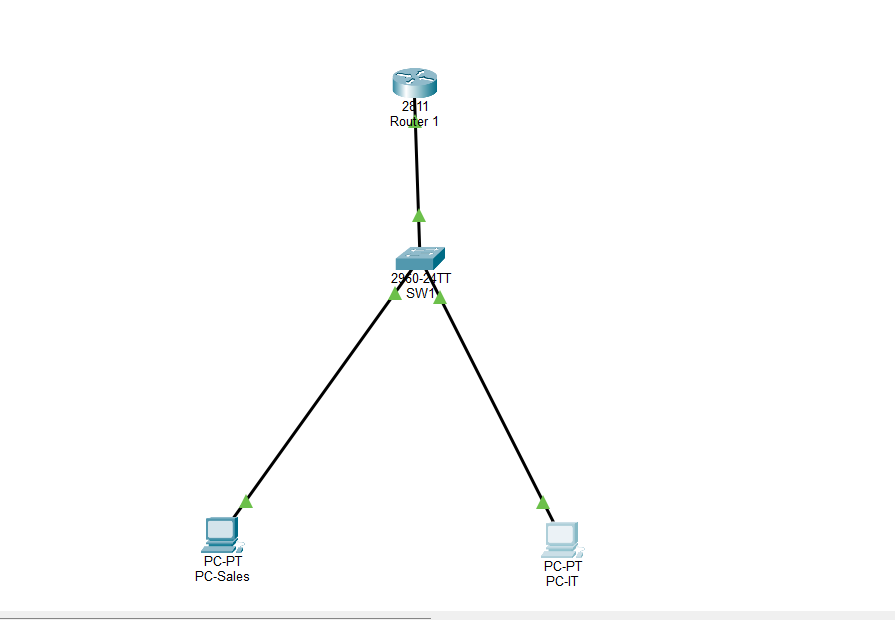
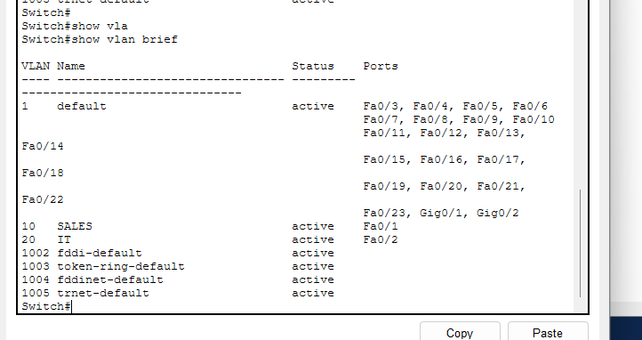
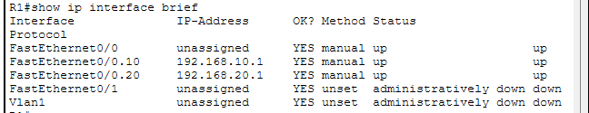
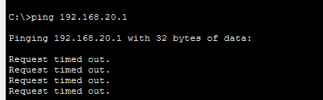
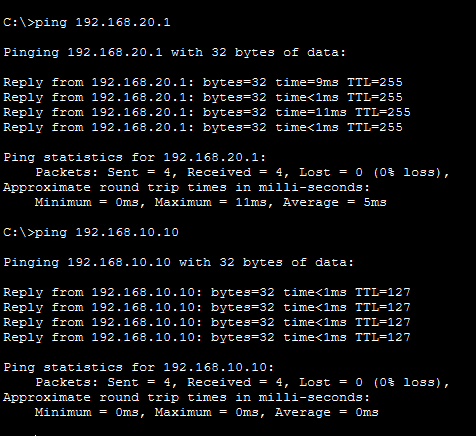

# Day 6 – Inter-VLAN Routing and Troubleshooting

## Project Overview

This lab focuses on Inter-VLAN Routing using the Router-on-a-Stick configuration and troubleshooting common network connectivity issues.

The objective was to configure communication between two VLANs and identify and resolve connectivity problems caused by incorrect VLAN assignments.

## Network Topology

The network consists of:

- One Cisco 2811 router (R1).
- One Cisco 2960 switch (SW1).
- One PC assigned to the SALES VLAN.
- One PC assigned to the IT VLAN.



## IP Addressing Scheme

| Device | IP Address | Subnet Mask | Default Gateway |
|---|---|---|---|
| PC-SALES | 192.168.10.10 | 255.255.255.0 | 192.168.10.1 |
| PC-IT | 192.168.20.10 | 255.255.255.0 | 192.168.20.1 |
| R1 VLAN 10 | 192.168.10.1 | 255.255.255.0 | N/A |
| R1 VLAN 20 | 192.168.20.1 | 255.255.255.0 | N/A |

## VLAN Configuration

Two VLANs were configured on SW1:

| VLAN ID | VLAN Name | Switch Port |
|---|---|---|
| 10 | SALES | Fa0/1 |
| 20 | IT | Fa0/2 |

The `show vlan brief` command was used to verify VLAN membership.



## Router-on-a-Stick Configuration

The router was configured with two subinterfaces on FastEthernet0/0:

```bash
interface FastEthernet0/0
no ip address
no shutdown

interface FastEthernet0/0.10
encapsulation dot1Q 10
ip address 192.168.10.1 255.255.255.0

interface FastEthernet0/0.20
encapsulation dot1Q 20
ip address 192.168.20.1 255.255.255.0
```

The `show ip interface brief` command was used to verify interface status and IP addressing.



## Troubleshooting Scenario

An intentional configuration error was introduced to practice network troubleshooting.

**Problem identified:**

- PC-IT was configured with IP address `192.168.20.10/24`.
- Its default gateway was `192.168.20.1`.
- Switch port Fa0/2 was incorrectly assigned to VLAN 10 instead of VLAN 20.
- PC-IT could not reach its default gateway.

The failed ping test helped identify the connectivity issue.



## Troubleshooting and Resolution

The following command was used to inspect VLAN membership:

```bash
show vlan brief
```

The issue was resolved by assigning Fa0/2 to the correct VLAN:

```bash
configure terminal
interface FastEthernet0/2
switchport mode access
switchport access vlan 20
end
```

The VLAN configuration was verified again using `show vlan brief`.

## Connectivity Verification

After correcting the VLAN assignment, connectivity was tested using:

```bash
ping 192.168.20.1
ping 192.168.10.10
```

Both tests were successful, confirming that PC-IT could reach its default gateway and communicate with PC-SALES across VLANs.



## Skills Practiced

- Inter-VLAN Routing.
- Router-on-a-Stick configuration.
- IEEE 802.1Q VLAN tagging.
- VLAN assignment and verification.
- Default gateway troubleshooting.
- Cisco IOS verification commands.
- Network connectivity testing with ICMP ping.

## Lab Status

**Completed & Verified**

The lab successfully demonstrated Inter-VLAN Routing and a practical troubleshooting scenario involving an incorrect switch port VLAN assignment.
