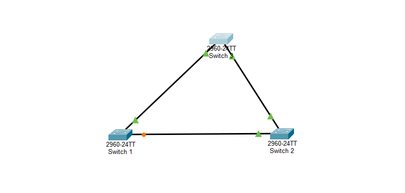
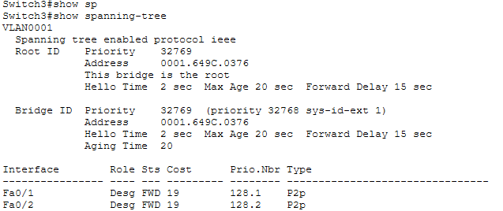
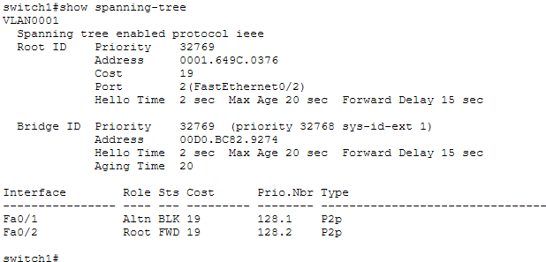
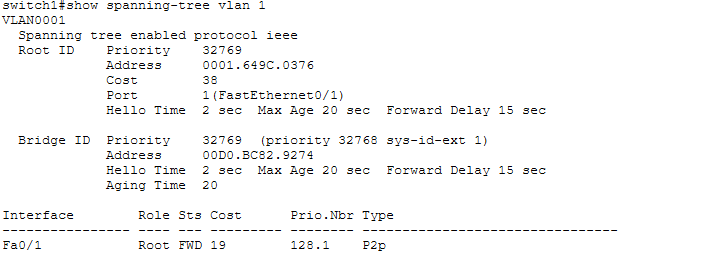
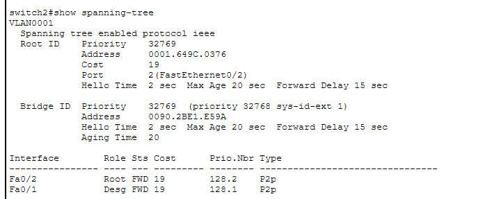
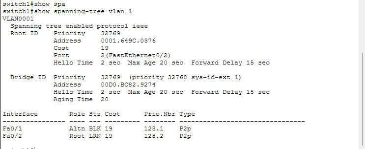

# Day 7 — Spanning Tree Protocol (STP)

## Project: PérezTech Solutions — Enterprise Network Infrastructure

### 1. Lab Objective

The objective of this lab was to understand how Spanning Tree Protocol (STP) prevents Layer 2 switching loops while maintaining redundant network paths.

The lab focused on identifying the Root Bridge, understanding STP port roles and states, simulating a link failure, and verifying network topology reconvergence.

### 2. Network Topology

The lab was built using three Cisco 2960 switches connected in a triangular topology:

- SW1
- SW2
- SW3

The redundant links allowed STP to calculate the best paths and block one redundant port to prevent Layer 2 loops.

**Topology Screenshot:**



### 3. Root Bridge Election

After executing `show spanning-tree` on all three switches, SW3 was identified as the Root Bridge.

Root Bridge information:

- Switch: SW3
- Priority: 32769
- MAC Address: 0001.649C.0376

SW3 had the lowest Bridge ID among the three switches.

**Root Bridge Verification:**



### 4. Initial STP Port Roles and States

The initial STP configuration showed the following port roles:

| Switch | Interface | Role | State |
|---|---|---|---|
| SW1 | Fa0/1 | Alternate | Blocking |
| SW1 | Fa0/2 | Root | Forwarding |
| SW2 | Fa0/1 | Designated | Forwarding |
| SW2 | Fa0/2 | Root | Forwarding |
| SW3 | Fa0/1 | Designated | Forwarding |
| SW3 | Fa0/2 | Designated | Forwarding |

SW1 Fa0/1 was placed in the Blocking state to prevent a Layer 2 switching loop.

**Initial Blocking Port Verification:**



### 5. Link Failure Simulation

A controlled failure was simulated by administratively shutting down SW1 FastEthernet0/2.

Commands used:

```bash
enable
configure terminal
interface fastEthernet 0/2
shutdown
end
```

The interface status was verified using:

```bash
show interfaces fastEthernet 0/2
```

The output confirmed that the interface was administratively down.

### 6. STP Convergence and Alternate Path Activation

After the primary link failed, STP recalculated the network topology.

SW1 Fa0/1 changed from Alternate Blocking to Root Forwarding.

The new path to the Root Bridge was:

SW1 → SW2 → SW3

The path cost increased from 19 to 38 because traffic had to travel through an additional switch link.

**STP Convergence Verification:**



**Backup Path Verification:**



### 7. Link Restoration

The primary link was restored using:

```bash
enable
configure terminal
interface fastEthernet 0/2
no shutdown
end
```

After STP reconverged, the original port roles and states returned:

| Interface | Role | State |
|---|---|---|
| Fa0/1 | Alternate | Blocking |
| Fa0/2 | Root | Forwarding |

This confirmed that STP recalculated the topology after the primary link was restored.

**Final STP Verification:**



### 8. Verification Commands

The following Cisco IOS commands were used during the lab:

```bash
show spanning-tree
show spanning-tree vlan 1
show interfaces fastEthernet 0/2
show ip interface brief
```

### 9. Skills Practiced

- Understanding Layer 2 switching loops.
- Understanding Spanning Tree Protocol operation.
- Identifying the Root Bridge.
- Understanding Root, Designated, and Alternate ports.
- Understanding Blocking, Learning, and Forwarding states.
- Interpreting STP path costs.
- Simulating link failures.
- Observing STP topology reconvergence.
- Verifying switch interfaces using Cisco IOS commands.

### 10. Lab Status

**Completed & Verified**

The lab successfully demonstrated Root Bridge election, redundant path blocking, alternate path activation after a simulated link failure, and restoration of the original STP topology.
